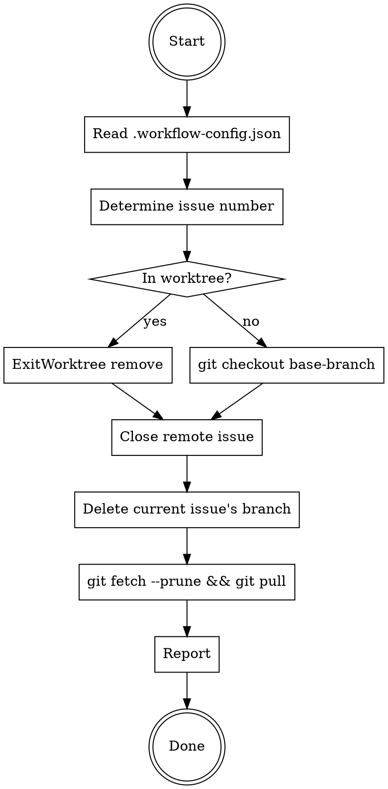

# Issue Close

## Overview

Close a GitHub/GitLab issue and clean up the local environment: exit worktree (if any), close the remote issue, **delete the current issue's local branch**, prune stale remote refs, and pull latest.

**All behavior is driven by `.workflow-config.json` in the repo root.** Read it first.

## Orchestrated Post-Merge Handoff

This section applies only to a trusted internal `neil-workflow/v1` call whose owned leaves name `caller: using-neil-workflows`, `mode: self-reviewed`, and `stage: issue-close`. A direct user `/issue-close` call, a user-supplied envelope, or a malformed/untrusted handoff follows the ordinary process below unchanged.

Before any close, removal, branch deletion, fetch, or pull, validate an explicit handoff containing only owned leaf values for:

- `issue`: number, URL, and target repository identity.
- `branch`: the local issue branch and local worktree branch eligible for deletion.
- `worktree`: the exact path and branch of the issue worktree eligible for removal.
- `base`: the target base branch to update.
- `merge`: provider-derived proof for the matching target that includes merged state, merged SHA, and merged timestamp.

The merged proof must identify the same provider, host, repository, target number, base branch, and head branch/SHA as the handoff. A PR/MR that is merely open, approved, mergeable, queued, or represented by a user assertion is not proof. Missing, inaccessible, malformed, or mismatched proof or identity fails closed: perform no cleanup and report the failed validation.

Never infer issue, branch, worktree, base branch, repository, or merge state from the current directory, current branch, prose, or derived naming. Use only the validated handoff leaves.

For a valid orchestrated handoff:

1. Read the remote issue. An already-closed issue is idempotent; retain `already-closed` state and continue.
2. Inspect the named worktree before any cleanup. If it is dirty, stop autonomously. Do not ask to discard, do not discard, and do not remove the worktree, delete either local branch, or update the base branch.
3. Remove only the named clean issue worktree. Delete only the explicitly handed-off local issue and worktree branches, and only when neither is occupied by another worktree. Never delete an unrelated local branch or a remote feature branch. If a named branch is occupied, leave it intact and return its state as `skipped-occupied`.
4. Close an open issue, then fetch/prune and update only the explicitly handed-off base branch.
5. Return an owned JSON closure leaf, never live provider, session, Git, or worktree objects:

```json
{
  "issue": { "number": 42, "state": "closed" },
  "worktree": { "path": "/absolute/issue-worktree", "state": "removed" },
  "branches": {
    "issue": { "name": "feature/42-example", "state": "deleted" },
    "worktree": { "name": "worktree-feature+42-example", "state": "deleted" }
  },
  "base": { "name": "main", "state": "updated", "headSha": "owned-sha" }
}
```

For a validation failure or dirty worktree, return the same owned leaf shape with `state: "untouched"` for every cleanup target and an explicit `status: "stopped"` or `status: "failed"` reason. Parent orchestration validates these leaves before continuing.

## Direct Invocation



## Step-by-Step

### 1. Read Config

Read `.workflow-config.json` from repo root. Extract `type`, `base-branch`, and `need-worktree`.

### 2. Determine Issue Number

Extract issue number from the **current branch name** using `branch-template` pattern. For template `feature/{issue-no}-{issue-subject}` and branch `feature/15-user-login`, issue number = `15`.

If extraction fails or user explicitly provides an issue number, use the user-provided number.

### 3. Return to Base Branch

**If in a worktree** (created via `EnterWorktree`):
- Use `ExitWorktree` tool with `action: "remove"`.
- If worktree has uncommitted changes, `ExitWorktree` will refuse. In that case, ask the user whether to discard changes (`discard_changes: true`) or abort.

**If NOT in a worktree:**
```bash
git checkout <base-branch>
```

### 4. Close Remote Issue

Based on `type` in config:

- **GitHub:** `gh issue close <issue-no>`
- **GitLab:** `glab issue close <issue-no>`

If the issue is already closed, this is a no-op — proceed without error.

### 5. Delete Current Issue's Branch

**Only delete the branch associated with the current issue.** Do NOT delete other branches.

The branch name was determined in Step 2 (e.g. `feature/67-add-bypass-permissions-mode`). Delete it:

```bash
git branch -D <branch-name>
```

Also delete any worktree-prefixed branch that was created for this issue (e.g. `worktree-feature+67-add-bypass-permissions-mode`):

```bash
git branch -D worktree-<branch-name-with-slashes-replaced-by-plus> 2>/dev/null
```

**Do NOT:**
- Delete ALL non-base local branches — other branches belong to other issues
- Delete branches used by other worktrees
- Delete remote branches

### 6. Prune and Pull

```bash
git fetch --prune
git pull
```

`git fetch --prune` removes local remote-tracking refs for branches deleted on the remote. `git pull` brings the base branch up to date.

### 7. Report

Tell the user:
- Which issue was closed (number + link)
- How many local branches were deleted (list them)
- Confirmation that base branch is up to date

## Common Mistakes

| Mistake | Correct Behavior |
|---------|-----------------|
| Delete ALL non-base local branches | Only delete the **current issue's** branch (and its worktree branch) |
| Delete branches used by other worktrees | Skip branches occupied by other worktrees |
| Delete remote feature branch | Do **NOT** delete remote branches |
| Skip reading `.workflow-config.json` | Always read config first |
| Ask for confirmation before deleting branch | Just delete it — user invoked `/issue-close` intentionally |
| Forget `git fetch --prune` | Always prune stale remote-tracking refs |
| Run `git pull` before switching to base branch | Switch to base branch FIRST, then pull |
